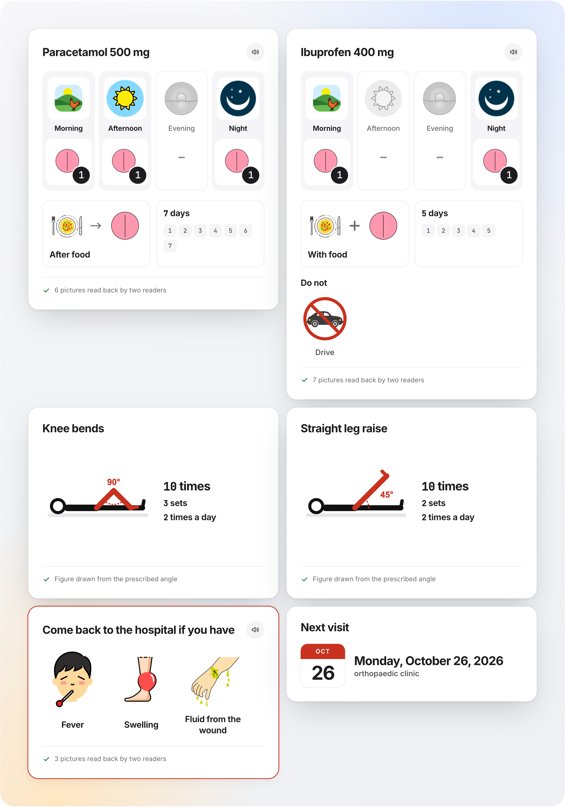

# Concord

Visual discharge instructions, verified before the patient sees them.

**Live site:** https://concord-beryl.vercel.app
**Built for:** Banana Hacks 2026 (image AI), solo, 9 to 12 October 2026

Concord turns a hospital discharge sheet into picture cards a patient can follow. An image model draws the pictures. Before a picture is shown, two other models have to look at it and say, in their own words, what it shows. If they get it wrong, the picture is thrown away and drawn again.



## The problem

A discharge sheet packs medicines, exercises and warning signs into a page or two of dense text. Published studies put numbers on what happens next:

- 78% of emergency patients went home with a gap in understanding their care or instructions in at least one area, and most did not know it ([Engel et al., 2009](https://psnet.ahrq.gov/issue/patient-comprehension-emergency-department-care-and-instructions-are-patients-aware-when-they), 140 patients).
- 46% of patients misread at least one of five prescription labels ([Davis et al., 2006](https://psnet.ahrq.gov/issue/literacy-and-misunderstanding-prescription-drug-labels), 395 patients).
- 19% of patients had an adverse event in the weeks after leaving hospital, and for 6% it was preventable ([Forster et al., 2003](https://pubmed.ncbi.nlm.nih.gov/12558354/), 400 patients).

Pictures help. In a randomized trial, low-literacy patients given pictogram labels understood and followed their medicines better ([trial, 2019](https://www.ijpsonline.com/articles/development-and-evaluation-of-a-pictogram-for-thai-patients-with-low-literate-skills-3590.html)). But a picture only helps if it is read correctly, and in one study just 1 of 12 standard medicine pictograms met the ISO bar for being understood ([study](https://turkmedline.net/detay/comprehensibility-of-pharmaceutical-pictograms-in-patient-information-leaflets-a-cross-sectional-study-in-ankara-turkiye/019dc352747347da/tr/409)).

An image generator can draw a pictogram for any instruction. It also miscounts pills, which a patient cannot afford. Concord is built around that fact.

## What it does

Paste the text of a discharge sheet, or photograph it. Concord returns:

- **A card for each medicine.** The four parts of the day always appear in the same order, with the dose under the times it is taken. Below that are the food rule, a calendar with one box per day, and anything to avoid.
- **Exercise cards** with a figure at the prescribed angle and the angle written on it.
- **A warning card** for the symptoms that should bring the patient back.
- **A follow-up card** with the date.

Labels come in seven languages. A card can be read aloud or printed. Anything the sheet says that the cards cannot hold (half tablets, tapering doses, "as needed") is shown as text and never drawn.

## How it works

| Step | What happens | Who decides |
|---|---|---|
| 1. Read the sheet | Two models from different vendors read the text or photo separately into a fixed structure. | Any field they disagree on is flagged for the user. |
| 2. Lay out the cards | Order, arrows, numbers, the calendar and the labels are placed by code. | Code. The image model never writes a number. |
| 3. Draw | FLUX.1 [dev] with a style adapter we trained draws one fact per picture: a time of day, one unit of a medicine, a meal, a thing to avoid, a symptom. | The image model, under the checks below. |
| 4. Read back | Two vision models are shown the picture with no hint and no list to choose from, and describe it in their own words. A separate text-only judge checks each description against a written rule for that picture. Pills are counted. | Both readers must pass. |
| 5. Redraw or fall back | A failed picture is redrawn up to three times. Each attempt is told what the last one got wrong, and redraws use the plain model without the adapter. If none passes, the card uses a plain pictogram drawn by code. | Code. Nothing unchecked is shown. |

A picture that passes is saved and reused, so "morning" is drawn and checked once.

### The style adapter

The plain model returns a different drawing style for almost every picture. We trained a LoRA adapter on 70 [OpenMoji](https://openmoji.org) pictograms with written captions (1,000 steps, 218 seconds on fal) so every picture shares one flat, outlined look. The training set is in [`training/`](training/) and the recipe is [`scripts/train.ts`](scripts/train.ts).

## What we measured

<!-- results:start -->
540 pictures were drawn for a fixed set of 100 written instructions, half with the plain model and half with our adapter. Both readers read every picture.

| What was measured | Result |
|---|---|
| Whole doses drawn in one picture that showed the wrong number | 83 of 168 |
| Single-unit pictures that passed on the first try | 58 of 60 |
| Pictures both readers called a flat outlined pictogram, plain model | 56 of 270 (21%) |
| The same, with our adapter | 210 of 270 (78%) |
| Written instructions the sheet reader got right | 100 of 100 |

Pictures that passed the read-back on the first try:

| Kind of picture | Plain model | With our adapter |
|---|---|---|
| One unit of a medicine | 29 of 30 | 29 of 30 |
| Time of day | 22 of 24 | 20 of 24 |
| Meal | 6 of 6 | 5 of 6 |
| Things to avoid | 28 of 36 | 28 of 36 |
| Warning signs | 30 of 60 | 12 of 60 |

Warning signs are the hard case. Fever came back as "a person's face with red tears and blue drool". A swollen foot came back as "a red sock". Strong pain came back as "a person with a red apple on their belly". The check threw all of these away. The site shows them under "What we measured".
<!-- results:end -->

Everything above is reproducible from the scripts in [`scripts/`](scripts/). The raw readings for every picture are in [`training/eval/`](training/eval/).

## What the measurements changed

We changed the design five times because of what the numbers showed.

1. **The generator cannot count.** Asked to draw a whole dose in one picture, it got the number wrong about half the time. Concord now asks for one unit, checks that it is exactly one, and repeats it by code. The count on a card is exact by construction.
2. **A multiple-choice check was too easy.** Our first read-back let readers pick from a list, and they passed a smiling man as "strong pain". Readers now describe the picture freely, and a judge checks each description against a written rule.
3. **Generated exercise figures were not reliable.** They failed the limb check too often, so exercise figures are drawn by code at the exact angle, like the calendar.
4. **The adapter fixed style and cost accuracy.** With it, 78% of pictures share one flat look, up from 21%. Warning signs got harder to read: 12 of 60 passed on the first try, against 30 of 60 with the plain model.
5. **So a redraw drops the adapter.** The first attempt is drawn in our style and redraws use the plain model. Worked out from the measured rates, that leaves about 32% of freshly drawn warning signs on the code-drawn marker, against 59% with the adapter on every attempt.

## Limits

- The readers are models. They catch a wrong drawing, but that is not the same as a patient understanding the card. No patient has used these cards yet.
- The test instructions are written from templates with realistic doses. Real discharge sheets are messier.
- The judge that compares descriptions is from the same vendor as one of the readers.
- Some warning signs are still hard to draw. Shortness of breath has no saved picture that passes, so that card shows a plain marker beside the words.
- Concord redraws what a sheet says. It gives no medical advice and does not check whether a dose is appropriate.

## Run it

```bash
pnpm install
cp .env.example .env.local   # add GEMINI_API_KEY, OPENAI_API_KEY, FAL_KEY
pnpm dev
```

| Script | What it does |
|---|---|
| `scripts/train.ts` | Trains the style adapter |
| `scripts/testset.ts` | Builds the 100-instruction test set |
| `scripts/eval-parse.ts` | Measures the sheet reader |
| `scripts/eval-tiles.ts` | Draws every tile several times and records the readings |
| `scripts/eval-style.ts` | Labels drawing style and judges saved descriptions again with the current rules |
| `scripts/audit-library.ts` | Re-checks the saved picture library |
| `scripts/labels.ts` | Translates labels and keeps those that survive a round trip |
| `scripts/report.ts` | Compiles the numbers shown on the site |

## Credits and licences

- **Pictures:** FLUX.1 [dev] by Black Forest Labs, run and fine-tuned on [fal](https://fal.ai).
- **Training set:** [OpenMoji](https://openmoji.org), CC BY-SA 4.0. The adapter and the pictures in `public/tiles/` are derived from it and are shared under the same licence.
- **Readers:** Gemini 3.8 Flash and Gemini 2.5 Flash (Google), GPT-6 Luna (OpenAI).
- **Libraries:** Next.js, React, zod, the fal, Google GenAI and OpenAI clients.
- **Evidence:** the studies linked above.

### AI tools used

The hackathon rules ask entrants to name these. Code was written with the help of Claude Code. The product itself uses the image and language models listed under Credits.

The code in this repository is MIT licensed.
